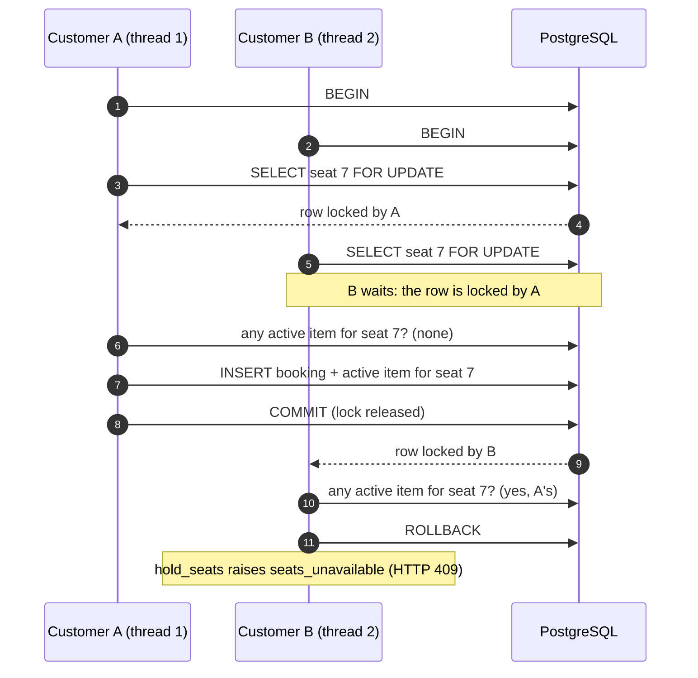

# Concurrency: How Double Booking Is Prevented

The hard problem in a booking system is not saving a booking. It is making sure two
people who click "Hold" on the same seat at the same moment can never both get it.
This project uses **two independent layers** of protection, both inside PostgreSQL.

## Layer 1: row locks in a consistent order

`bookings.services.hold_seats` runs everything inside one `transaction.atomic()` block:

1. **Lock the requested seat rows**: `bookings.services._lock_seats` runs
   `Seat.objects.select_for_update().filter(event=..., pk__in=...).order_by("pk")`, which
   becomes `SELECT ... FOR UPDATE ... ORDER BY id`. A second transaction that wants any
   of the same seats **waits** at this line until the first one commits or rolls back.
2. **Re-read the event** (`_ensure_event_open_for_booking`): the read happens after
   the locks are granted, so it sees a cancellation that committed while we waited.
3. **Lazy expiry** (`release_expired_holds`): stale holds on these seats are expired
   through `expire_booking`, which locks each booking row and re-checks it.
4. **Check the user has no other pending hold** for the event (`_ensure_user_has_no_active_hold`).
5. **Check availability** (`_ensure_seats_are_free`): any *active* `BookingItem` for
   these seats means they are taken, so the call raises `seats_unavailable` (409) and
   creates nothing.
6. **Create** the `Booking` and its `BookingItem` rows, then commit (which releases the locks).

Because the waiting transaction only continues after the winner has committed, its
availability check (step 5) sees the winner's items, and it returns 409.

### Why "ordered by seat id" matters

Without a fixed order, user A could lock seat 1 and wait for seat 2 while user B
locks seat 2 and waits for seat 1, a deadlock. With `ORDER BY id`, both lock seat 1
first. Whoever gets it also gets seat 2; the other waits on seat 1 and never holds a
lock the winner needs.

### Global lock order

Every code path that takes more than one row lock follows the same order:

```
Event  ->  Seats (ascending id)  ->  Booking  ->  Payment  ->  PromoCode
```

The hold path uses `Seats -> Booking` (lazy expiry locks the stale booking after the
seats). The payment and cancellation paths added in later phases follow the same order.

## Layer 2: database constraints (the last line of defense)

Even if a future code path forgot to lock, PostgreSQL refuses invalid data:

| Constraint | Guarantees |
|---|---|
| `bookings_one_active_item_per_seat`: `UNIQUE (seat_id) WHERE is_active` | a seat can be in at most one active booking item |
| `bookings_one_pending_per_user_event`: `UNIQUE (user_id, event_id) WHERE status = 'pending'` | a user has at most one pending hold per event, even if they double-click |

If a constraint is ever violated, `bookings.services._conflict_from_integrity_error`
reads the constraint name from the psycopg error and turns it into the same 409 the
normal checks return (`seats_unavailable` or `active_hold_exists`).

Proved by `bookings/tests/test_hold_service.py::DatabaseConstraintFallbackTests`, which
switch off the application check and show that the constraint alone still prevents
the double booking.

## Expiry under concurrency

`bookings.services.expire_booking` locks the booking row (`SELECT ... FOR UPDATE`) and
re-checks `status == pending and expires_at <= now` **after** the lock is granted.
When the sweep and a hold (lazy expiry) race to expire the same booking, one waits
for the other; the second then sees `expired` and does nothing. The sweep locks only
booking rows, never seats, so it cannot form a lock cycle with a hold, which locks
seats first and then bookings.

## Idempotent payment webhooks

Providers retry webhooks, sometimes several deliveries of the same event at the same
moment. `payments.services.process_webhook` makes each `event_id` take effect once:

1. Verify the HMAC signature (constant time) and parse the body.
2. In one `transaction.atomic()` block, **first** insert the `WebhookEvent` row. Its
   `event_id` is unique (`payments_webhook_unique_event_id`).
3. Then lock and apply: seats (ascending id), then the booking
   (`bookings.services.lock_booking_with_seats`), then the payment (`select_for_update`).
4. Store the outcome and commit.

A concurrent duplicate blocks on step 2: PostgreSQL makes its `INSERT` wait on the
unique index until the first transaction finishes. If the first commits, the
duplicate fails with `IntegrityError`, which is caught (only for that constraint name)
and answered with `200 {"status": "duplicate"}`. If the first rolls back, for example
after a crash, the duplicate's insert succeeds and it processes the event, so a
retried delivery is never lost.

```mermaid
sequenceDiagram
    autonumber
    participant P1 as Delivery 1
    participant P2 as Delivery 2 (same event_id)
    participant DB as PostgreSQL

    P1->>DB: BEGIN; INSERT webhook_event(evt_1)
    P2->>DB: BEGIN; INSERT webhook_event(evt_1)
    Note over P2,DB: waits on the unique index
    P1->>DB: lock seats, booking, payment
    P1->>DB: payment succeeded, booking confirmed
    P1->>DB: COMMIT
    DB-->>P2: unique violation (IntegrityError)
    P2->>DB: ROLLBACK
    Note over P2: returns 200 duplicate; nothing changed
```

## Payment confirmation vs. expiry

The webhook takes the same locks a hold takes (seats, then the booking). The expiry
sweep takes only the booking lock. Whichever gets the booking row first wins, and the
other re-checks after its lock is granted:

- webhook first: the booking is confirmed; the sweep then sees `confirmed` and skips it;
- sweep first: the booking is expired; the webhook then applies the late-webhook rule
  under its seat locks. Because it holds those locks, no hold can take the seats
  between "seats are free" and "reactivate the items".

Either way the booking ends `confirmed` with every item active, or `expired` with a
full refund. It never ends confirmed with inactive items.

## Cancellations under concurrency

- **Double cancel:** `cancel_booking` locks the booking row first. Concurrent cancels
  queue up behind each other; the first cancels and refunds, the rest find the booking
  `cancelled` and return the original result. `Refund.payment` is one-to-one, so even a
  buggy path could not create a second refund.
- **Event cancel vs. holds:** `cancel_event` locks the event, then **every seat** of the
  event in ascending id order (the same order holds use), then the bookings. A hold that
  already has its seat lock finishes first, and the cancellation then cancels the new
  booking. A hold that arrives later waits for the seat, re-reads the event after the
  lock and gets `event_not_bookable`.

### A real deadlock found by the tests: `FOR UPDATE` vs. foreign keys

The first version of `cancel_event` locked the event row with a plain
`SELECT ... FOR UPDATE`. `EventCancelVersusHoldRaceTests` failed in 5 of 5 rounds with
`deadlock detected`:

1. a hold had locked seat 7 and was inserting its `Booking`;
2. the `INSERT` checks the foreign key `booking.event_id`, which takes a `FOR KEY SHARE`
   lock on the event row;
3. `cancel_event` held `FOR UPDATE` on that event row (which conflicts with
   `FOR KEY SHARE`) and was waiting for seat 7.

Each transaction waited for the other. **Fix:** every row lock in the project is now
`select_for_update(no_key=True)`, which is `FOR NO KEY UPDATE`. It still excludes every
other locker and writer, so all the mutual exclusion above is unchanged, but it does
not block foreign-key checks from inserts that merely *reference* the row. It is the lock
PostgreSQL itself uses for an ordinary `UPDATE` that does not change the key, and
this project never changes primary keys. Reverting only that one lock brings the
deadlock back (5/5 rounds); with the fix the test passes, and the whole concurrency set
passed 10 runs in a row.

## Limited promo-code uses (F2)

`bookings.promotions.reserve_promo_use` locks the promo row (`FOR NO KEY UPDATE`),
checks `times_used < max_uses` and increments it, all under the lock, so "check then
increment" cannot interleave. A check constraint `times_used <= max_uses` backs it up.
The promo row is always the **last** lock taken (after seats, bookings and payments), and
`cancel_event` locks every payment before releasing any promo use, so no lock cycle is
possible. `FOR NO KEY UPDATE` matters here too: other holds can still insert bookings
that reference the same promo code (their foreign-key check takes `FOR KEY SHARE`).
Proven by `bookings/tests/test_promotions.py::LastPromoUseRaceTests`: 20 customers, each
on a different seat, race for the last of 5 uses; exactly one gets the discount and 19 get
`promo_exhausted`, and `times_used` ends at exactly 5.

## Idempotent client retries (F1)

`core.idempotency.run_idempotent` uses the same "insert the unique row first" pattern as
the webhook: inside one transaction it inserts `IdempotencyRecord(user, scope, key)`,
runs the action and stores the response. A concurrent retry with the same key blocks on
the unique index until the first transaction commits, then reads and replays the
stored response. If the first attempt rolls back, the retry's insert succeeds and it
runs the action itself. Proven by
`core/tests/test_idempotency.py::ConcurrentIdempotentRetryTests` (5 simultaneous
requests: one booking, five identical 201 responses, four marked as replays; looped 10
times, 10/10 passed).

## Availability is derived, not stored

There is no `Seat.status` column to keep in sync. A seat is taken if it has an active
`BookingItem` whose booking is confirmed, or pending with `expires_at > now`
(`events.selectors.list_seats_with_status`). A stale hold (pending, past `expires_at`)
already shows as available, and the next hold on that seat releases it.

## What happens when two users hold the same seat



If B's request had somehow skipped the lock, its `INSERT` would violate
`bookings_one_active_item_per_seat` and still end in the same 409.

## What each concurrency test proves

All tests are in `bookings/tests/test_concurrency.py`. They use `TransactionTestCase`
(real commits, visible to other connections), real threads, one PostgreSQL connection
per thread, and a `threading.Barrier` so every thread starts its transaction at the
same moment (`core/tests/concurrency.py::run_concurrently`). A thread that raises
anything other than the expected `ConflictError`, for example a deadlock error, fails
the test. A thread that hangs for 60 seconds fails it too.

| Test | Scenario | Proves |
|---|---|---|
| `SameSeatRaceTests.test_twenty_users_racing_for_one_seat_produce_exactly_one_hold` | 20 customers hold one seat at once | exactly 1 success, 19 clean `seats_unavailable`, exactly 1 active item |
| `OverlappingHoldsRaceTests.test_reverse_ordered_overlapping_holds_never_deadlock_or_split` | A wants 1,2,3 and B wants 3,2,1 (10 rounds) | ordered locking: no deadlock, one winner takes all three seats, no partial booking |
| `OverlappingHoldsRaceTests.test_many_random_overlapping_holds_leave_a_consistent_seat_map` | 10 customers grab random 3-of-6 seat sets | every winner owns exactly its seats, every loser created nothing, no seat has two active items |
| `SameUserDoubleClickRaceTests.test_simultaneous_holds_by_one_user_create_only_one_pending_booking` | one customer fires 5 holds on different seats at once | the `(user, event) WHERE pending` constraint stops the race the seat locks cannot see |
| `ActiveItemConstraintTests` (3 tests) | raw inserts and updates that bypass the service | PostgreSQL itself rejects a second active item for a seat; inactive history is allowed |
| `bookings/tests/test_expiry.py::HoldVersusExpiryRaceTests.test_sweep_and_new_hold_on_the_same_seat_leave_a_consistent_state` | `expire_holds` sweep and a new hold on the stale seat at the same time (10 rounds) | the stale hold is expired exactly once (by whichever gets the booking lock first), the new hold wins, no seat is double-active |
| `bookings/tests/test_expiry.py::HoldVersusExpiryRaceTests.test_parallel_sweeps_expire_each_booking_exactly_once` | three sweeps at once over 5 stale holds | the expired counts add up to exactly 5: the sweep is safe to run concurrently with itself |
| `bookings/tests/test_cancellation_concurrency.py::DoubleCancelRaceTests` | the same confirmed booking cancelled by 5 requests at once | exactly one refund; every reply carries that same refund |
| `bookings/tests/test_cancellation_concurrency.py::EventCancelVersusHoldRaceTests` | an organizer cancels the event while 4 customers hold seats (5 rounds) | no active booking or seat survives the cancellation, holds fail cleanly, no deadlock |
| `payments/tests/test_payment_concurrency.py::DuplicateWebhookRaceTests` | the same webhook `event_id` delivered by 10 threads at once | exactly one `confirmed`, nine `duplicate`, one `WebhookEvent` row, no refund |
| `payments/tests/test_payment_concurrency.py::ConfirmVersusExpireRaceTests` (2 tests, 10 rounds each) | successful payment and expiry sweep at the expiry instant, and payment 1 s before vs. sweep 1 s after | the booking is either confirmed with all items active and the payment kept, or expired with a refund, never both |

### Evidence that the tests detect real races

As a one-off experiment (not committed), the `select_for_update()` call in
`_lock_seats` and the constraint translation were removed. The 20-user test then
failed: concurrent requests got past the availability check, and PostgreSQL raised
`IntegrityError: duplicate key value violates unique constraint
"bookings_one_active_item_per_seat"`. Only the database constraint prevented the double
booking. With the lock restored the test passes, and the same 7 tests passed 10 runs
in a row (`for i in 1..10: manage.py test bookings.tests.test_concurrency`). After Phase 6, all concurrency tests (holds, expiry and payments) passed 10 runs in
a row as well.

## Running the concurrency tests

```powershell
.\.venv\Scripts\python manage.py test bookings.tests.test_concurrency bookings.tests.test_expiry bookings.tests.test_cancellation_concurrency payments.tests.test_payment_concurrency -v 2
```

They need PostgreSQL. They run in CI on every push, together with the rest of the suite.
