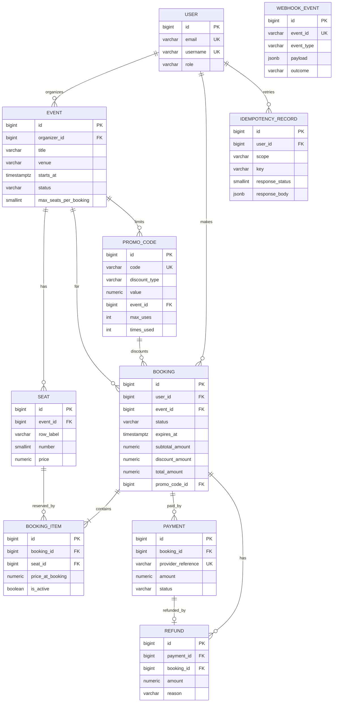

# Database

PostgreSQL 18. All timestamps are stored as timezone-aware UTC. Primary keys are
`BigAutoField` (64-bit integers).

## Tables

### `accounts_user` (`accounts.User`)

Extends Django's `AbstractUser`.

| Column | Type | Notes |
|---|---|---|
| `id` | bigint | primary key |
| `email` | varchar(254) | unique; login identifier; stored lowercase |
| `username` | varchar(150) | unique (inherited from `AbstractUser`) |
| `role` | varchar(20) | `customer`, `organizer` or `admin` (default `customer`) |
| `password`, `is_active`, `is_staff`, `is_superuser`, `date_joined`, ... | | inherited |

Constraints:

| Name | Rule |
|---|---|
| `accounts_user_email_ci_unique` | unique on `lower(email)`: no two accounts differ only by case |
| `accounts_user_role_valid` | `role IN ('customer', 'organizer', 'admin')` |

### Token blacklist tables (from `djangorestframework-simplejwt`)

| Table | Purpose |
|---|---|
| `token_blacklist_outstandingtoken` | every issued refresh token (`jti`, `user_id`, expiry) |
| `token_blacklist_blacklistedtoken` | refresh tokens revoked by logout or rotation |

### `events_event` (`events.Event`)

| Column | Type | Notes |
|---|---|---|
| `id` | bigint | primary key |
| `organizer_id` | bigint | FK `accounts_user` (`PROTECT`: users with events cannot be deleted) |
| `title`, `venue` | varchar(200) | |
| `description` | text | optional |
| `starts_at` | timestamptz | |
| `status` | varchar(20) | `draft`, `published`, `cancelled` |
| `max_seats_per_booking` | smallint | 1 to 20, default 6 |
| `created_at`, `updated_at` | timestamptz | |

Constraints and indexes:

| Name | Rule |
|---|---|
| `events_event_status_valid` | `status IN ('draft', 'published', 'cancelled')` |
| `events_event_max_seats_range` | `1 <= max_seats_per_booking <= 20` |
| `events_status_starts_idx` | index on `(status, starts_at)` for the public list |

### `events_seat` (`events.Seat`)

| Column | Type | Notes |
|---|---|---|
| `id` | bigint | primary key; also the lock order for holds |
| `event_id` | bigint | FK `events_event` (`CASCADE`) |
| `row_label` | varchar(2) | `A` to `Z` |
| `number` | smallint | from 1 |
| `price` | numeric(12, 2) | never negative |

There is deliberately **no status column**: availability is derived from bookings.

| Name | Rule |
|---|---|
| `events_seat_unique_position` | unique `(event_id, row_label, number)` |
| `events_seat_price_not_negative` | `price >= 0` |
| `events_seat_number_positive` | `number >= 1` |

### `bookings_booking` (`bookings.Booking`)

| Column | Type | Notes |
|---|---|---|
| `id` | bigint | primary key |
| `user_id` | bigint | FK `accounts_user` (`PROTECT`) |
| `event_id` | bigint | FK `events_event` (`PROTECT`) |
| `status` | varchar(20) | `pending`, `confirmed`, `cancelled`, `expired` |
| `expires_at` | timestamptz | end of the hold; required while pending |
| `subtotal_amount` | numeric(12, 2) | sum of `price_at_booking` |
| `discount_amount` | numeric(12, 2) | promo discount, 0 without a code |
| `total_amount` | numeric(12, 2) | `subtotal - discount`: the amount to pay |
| `promo_code_id` | bigint | FK `bookings_promocode`, nullable |
| `confirmed_at`, `cancelled_at` | timestamptz | set by the payment and cancellation phases |
| `created_at`, `updated_at` | timestamptz | |

| Name | Rule |
|---|---|
| `bookings_one_pending_per_user_event` | **partial unique** `(user_id, event_id) WHERE status = 'pending'` |
| `bookings_booking_status_valid` | `status` is one of the four values |
| `bookings_booking_total_not_negative` | `total_amount >= 0` |
| `bookings_pending_has_expiry` | a pending booking always has `expires_at` |
| `bookings_total_is_subtotal_minus_discount` | `0 <= discount <= subtotal` and `total = subtotal - discount` |
| `bookings_status_expires_idx` | index `(status, expires_at)` for the expiry job |
| `bookings_user_created_idx` | index `(user_id, created_at DESC)` for "my bookings" |

### `bookings_bookingitem` (`bookings.BookingItem`)

| Column | Type | Notes |
|---|---|---|
| `id` | bigint | primary key |
| `booking_id` | bigint | FK `bookings_booking` (`CASCADE`) |
| `seat_id` | bigint | FK `events_seat` (`PROTECT`: seats with bookings cannot be deleted) |
| `price_at_booking` | numeric(12, 2) | price copied when the hold was made |
| `is_active` | boolean | true while the booking is pending (valid) or confirmed |

| Name | Rule |
|---|---|
| `bookings_one_active_item_per_seat` | **partial unique** `(seat_id) WHERE is_active`: **the database guarantee against double booking** |
| `bookings_item_unique_seat_per_booking` | unique `(booking_id, seat_id)` |
| `bookings_item_price_not_negative` | `price_at_booking >= 0` |

### `payments_payment` (`payments.Payment`)

| Column | Type | Notes |
|---|---|---|
| `id` | bigint | primary key |
| `booking_id` | bigint | FK `bookings_booking` (`PROTECT`) |
| `provider` | varchar(30) | `fake` (test mode) |
| `provider_reference` | varchar(100) | **unique**; the id the provider uses in webhooks |
| `amount` | numeric(12, 2) | equals the booking total |
| `status` | varchar(20) | `pending`, `succeeded`, `failed`, `refunded` |
| `created_at`, `updated_at` | timestamptz | |

| Name | Rule |
|---|---|
| `payments_one_pending_payment_per_booking` | **partial unique** `(booking_id) WHERE status = 'pending'` |
| `payments_payment_status_valid` | `status` is one of the four values |
| `payments_payment_amount_not_negative` | `amount >= 0` |

### `payments_webhookevent` (`payments.WebhookEvent`)

| Column | Type | Notes |
|---|---|---|
| `id` | bigint | primary key |
| `provider` | varchar(30) | |
| `event_id` | varchar(100) | **unique** (`payments_webhook_unique_event_id`): the idempotency key |
| `event_type` | varchar(50) | `payment.succeeded` or `payment.failed` |
| `payload` | jsonb | the full body as received |
| `status` | varchar(20) | `processed` or `ignored` |
| `outcome` | varchar(30) | what processing did (`confirmed`, `refunded_late`, ...) |
| `received_at`, `processed_at` | timestamptz | |

### `payments_refund` (`payments.Refund`)

| Column | Type | Notes |
|---|---|---|
| `id` | bigint | primary key |
| `payment_id` | bigint | **one-to-one** FK `payments_payment`: at most one refund per payment |
| `booking_id` | bigint | FK `bookings_booking` |
| `amount` | numeric(12, 2) | `> 0` (`payments_refund_amount_positive`), never more than the payment |
| `reason` | varchar(30) | `customer_cancellation`, `event_cancelled`, `late_payment`, `duplicate_payment`, `booking_cancelled` |
| `status` | varchar(20) | `succeeded` (test mode settles instantly) |
| `created_at` | timestamptz | |

### `bookings_promocode` (`bookings.PromoCode`)

| Column | Type | Notes |
|---|---|---|
| `id` | bigint | primary key |
| `code` | varchar(40) | unique, stored upper-case |
| `discount_type` | varchar(10) | `percent` or `fixed` |
| `value` | numeric(12, 2) | `> 0`; at most 100 for `percent` |
| `event_id` | bigint | FK `events_event`, nullable (empty = every event) |
| `valid_from`, `valid_until` | timestamptz | `valid_until > valid_from` |
| `max_uses`, `times_used` | integer | `times_used <= max_uses` (`bookings_promo_uses_within_limit`) |
| `is_active` | boolean | |

Migration `bookings/migrations/0002_promo_codes.py` copies `total_amount` into `subtotal_amount` for
existing bookings before adding the new check constraint.

### `core_idempotencyrecord` (`core.IdempotencyRecord`)

| Column | Type | Notes |
|---|---|---|
| `id` | bigint | primary key |
| `user_id` | bigint | FK `accounts_user` (`CASCADE`) |
| `scope` | varchar(40) | endpoint name: `hold` or `pay` |
| `key` | varchar(255) | the client's `Idempotency-Key` |
| `request_fingerprint` | varchar(64) | SHA-256 of method, path and JSON body |
| `response_status`, `response_body` | smallint, jsonb | the stored answer |
| `created_at`, `expires_at` | timestamptz | records live 24 hours |

| Name | Rule |
|---|---|
| `core_idempotency_unique_user_scope_key` | unique `(user_id, scope, key)`: concurrent retries serialise on it |
| `core_idempotency_expires_idx` | index on `expires_at` for the purge command |

## How the indexes are used (measured in Phase 12)

| Read path | Index that serves it |
|---|---|
| Seat map status | `bookings_one_active_item_per_seat` (partial, `seat_id WHERE is_active`): one probe per seat |
| Public list seat count / lowest price | FK index `events_seat(event_id)` via per-event subqueries |
| Report sold / held / revenue | FK indexes `bookings_booking(event_id)`, `bookings_bookingitem(booking_id)`, `payments_payment(booking_id)`, `payments_refund(booking_id)` |
| Expiry sweep | `bookings_status_expires_idx (status, expires_at)` |
| "My bookings" | `bookings_user_created_idx (user_id, created_at DESC)` |
| One pending hold per user and event | `bookings_one_pending_per_user_event` (partial unique) |

No new index was needed: every slow path was a query-shape problem, not a missing index.

## ER diagram

