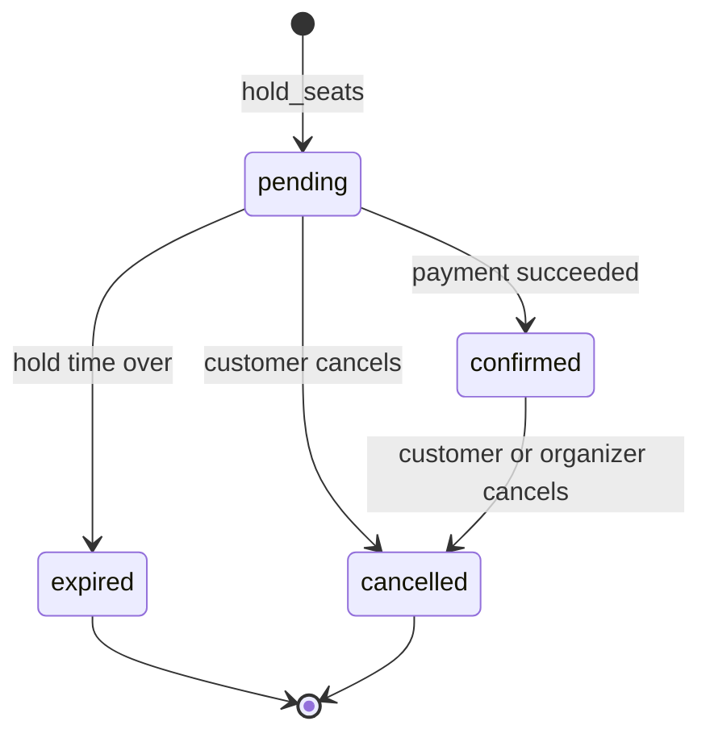

# Business Logic

This file describes the business rules as they exist in the code. Sections are added
as each phase is implemented.

## Accounts and roles

- Every user has exactly one role: `customer`, `organizer` or `admin`
  (`accounts.models.Role`).
- Sign-up (`accounts.services.register_user`) allows `customer` or `organizer` only.
  Emails are stored lowercase and are unique regardless of case.
- Passwords must pass Django's validators (minimum length, not common, not only digits,
  not too similar to the email or username): `accounts.serializers.RegisterSerializer.validate`.
- Login uses email and password and returns a JWT pair. Refresh tokens rotate, and the
  old one is blacklisted. Logout (`accounts.services.revoke_refresh_token`) blacklists the
  caller's own refresh token.
- Register, login and refresh are throttled to 10 requests per minute per client
  (scope `auth`).

**Who can do what** (`accounts/permissions.py`):

| Permission class | Roles allowed |
|---|---|
| `IsCustomer` | customer |
| `IsOrganizer` | organizer |
| `IsOrganizerOrAdmin` | organizer, admin |
| `IsAdminRole` | admin |

`scope_to_owner(queryset, user, owner_field)` returns everything for admins and only the
caller's own rows for everyone else. A request for someone else's object therefore
returns 404, which also hides that the object exists.

## Events and seats

**Event lifecycle** (`events.models.EventStatus`): `draft -> published`,
`published -> draft` (unpublish, only without active bookings), and
`draft | published -> cancelled` (with full refunds).

| Rule | Where |
|---|---|
| New events are always `draft`, owned by the creating organizer | `events.services.create_event` |
| Start time must be in the future (create, update, publish) | `events.services._ensure_starts_in_future` |
| Cancelled events cannot be edited | `events.services.update_event` |
| Only drafts can be deleted; published events must be cancelled | `events.services.delete_event` |
| Seats are generated once, only for drafts | `events.services.generate_seats` |
| Publishing needs: draft status, at least one seat, future start | `events.services.publish_event` |
| Unpublishing needs: published status and no confirmed booking or valid hold (stale holds do not count); it locks the event and its seats like a cancellation | `events.services.unpublish_event` |
| `max_seats_per_booking` is 1 to 20 (default 6) | `events.models.MAX_SEATS_PER_BOOKING_LIMIT` |

**Seat generation** (`events.services.generate_seats`): rows are labelled `A` to `Z`
(max 26), seats are numbered from 1 (max 50 per row). Price tiers apply from the
front row backwards and must cover every row exactly once.

Example: `rows=3, seats_per_row=4, price_tiers=[{rows: 1, price: 500.00}, {rows: 2, price: 300.00}]`
creates `A1-A4` at 500.00 and `B1-B4`, `C1-C4` at 300.00 (12 seats).

**Public visibility** (`events.selectors`): the public list shows only `published`
events that have not started (`list_public_events`); detail and seat map show any
`published` event (`get_public_event`). Drafts and cancelled events return 404.

**Seat status** is derived, never stored (`events.selectors.list_seats_with_status`):

| Status | Condition |
|---|---|
| `booked` | an active `BookingItem` belongs to a `confirmed` booking |
| `held` | an active `BookingItem` belongs to a `pending` booking with `expires_at > now` |
| `available` | anything else, including a stale hold (pending with `expires_at <= now`) |

## Booking state machine

Defined once in `bookings.services.ALLOWED_TRANSITIONS` and enforced by
`bookings.services.ensure_transition_allowed`:



`expired` and `cancelled` are terminal. Any other move raises `invalid_status_transition` (409).

**One documented exception:** `expired -> confirmed` is allowed only for a late
successful payment whose seats are all still free (`bookings.services.LATE_PAYMENT_RECOVERY`,
used only inside `confirm_paid_booking`). See "Late webhook" below.

A pending booking whose `expires_at <= now` **counts as expired** even before the row
is updated (`Booking.status_at`), so the API already reports it as `expired`.

## Holding seats

`bookings.services.hold_seats(user, event_id, seat_ids, now)` (endpoint
`POST /api/bookings/hold/`, customers only, throttled at 30 per minute):

| Rule | Error |
|---|---|
| At least one seat, no duplicates | 400 `no_seats` / `duplicate_seats` |
| Event exists and is published | 404 |
| At most `event.max_seats_per_booking` seats | 400 `too_many_seats` |
| Every seat belongs to the event | 400 `seat_not_in_event` (lists the bad ids) |
| Event still published and not started (checked after locking) | 409 `event_not_bookable` |
| User has no other pending hold for this event | 409 `active_hold_exists` |
| No requested seat is held or booked by anyone | 409 `seats_unavailable` (lists the seats) |

On success: one `pending` booking with `expires_at = now + HOLD_TTL_MINUTES` (default
10), `total_amount` = sum of seat prices, and one active `BookingItem` per seat, with
`price_at_booking` copied from the seat.

**Worked example:** at 18:00 a customer holds A1 and A2 (100.00 each). Result: pending
booking, total 200.00, expires 18:10. Another customer asking for A2 and A3 at 18:05
gets 409 `seats_unavailable` with `seats: ["A2"]`, and nothing is created for them.
At 18:10 or later, a hold for A2 succeeds: the stale hold is expired first (lazy expiry).

## Hold expiry

A pending booking with `expires_at <= now` counts as expired. Exactly at `expires_at`
it is already expired; one second before, it is still valid.

`bookings.services.expire_booking(booking_id, now)` is the **only** function that expires
a hold. It locks the booking row and, if the booking is still `pending` with
`expires_at <= now`, sets `expired` and deactivates all its items. Otherwise it returns
False and changes nothing, so repeated or concurrent calls are harmless.

Two callers share it:

| Caller | When | What |
|---|---|---|
| Lazy expiry: `bookings.services.release_expired_holds` | at the start of every `hold_seats` | expires stale holds on the requested seats (and the user's own stale hold for the event) |
| Sweep: `bookings.services.expire_due_holds`, run by `python manage.py expire_holds` | periodically (cron) | expires every stale hold and prints `Expired N hold(s).` |

**Worked example:** holds H1 (expires 18:10), H2 (18:12) and H3 (18:20). A sweep at
18:15 expires H1 and H2 and returns 2; H3 stays pending. Running it again at 18:15
returns 0. If a customer asked for one of H1's seats at 18:11, before any sweep, the
hold would expire H1 on the spot and get the seat.

The sweep is only cleanup: correctness never depends on it running on time.

## Reading bookings

`bookings.selectors.bookings_visible_to(user)`: customers see their own bookings,
organizers see bookings for their own events, admins see all. Someone else's booking
returns 404 (`get_booking_for_user`).

## Payments (test mode)

**1. Start a payment:** `POST /api/bookings/{id}/pay/` calls `payments.services.start_payment`.
The booking must be the caller's own (otherwise 404), `pending`, and not past
`expires_at` (otherwise 409 `hold_expired` or `booking_not_payable`). It creates a
`pending` `Payment` for exactly `booking.total_amount` with a unique
`provider_reference` (`pay_...`). Asking again returns the same pending payment (200).

**2. The provider calls the webhook:** `POST /api/payments/webhook/` with the raw JSON body

```json
{"event_id": "evt_...", "type": "payment.succeeded",
 "data": {"provider_reference": "pay_...", "amount": "300.00"}}
```

and the header `X-Payment-Signature: <hex HMAC-SHA256 of the raw body with PAYMENT_WEBHOOK_SECRET>`
(`payments.provider.FakePaymentProvider.sign`).

**3. Processing** (`payments.services.process_webhook`):

| Check | Result |
|---|---|
| No signature header | 401 `missing_signature` |
| Signature does not match the body (`hmac.compare_digest`) | 403 `invalid_signature` |
| Body is not a valid payload | 400 `invalid_payload` |
| `event_id` already processed | 200 `{"status": "duplicate"}`, nothing changes |
| Unknown `provider_reference` | 200 ignored, `unknown_payment` |
| Payment is no longer `pending` | 200 ignored, `payment_not_pending` |
| `payment.failed` | payment `failed`; the booking stays pending until its hold expires (a retry is possible) |
| `payment.succeeded` with an amount different from the booking total | payment `failed`, `amount_mismatch` |
| `payment.succeeded`, correct amount | payment `succeeded`, then see the next table |

**Late webhook and other outcomes** (`bookings.services.confirm_paid_booking`):

| Booking state when the money arrives | Outcome |
|---|---|
| pending, hold still valid | `confirmed`: status `confirmed`, `confirmed_at` set, items stay active |
| hold expired (marked or not), all seats still free | `confirmed_late`: items reactivated, booking confirmed |
| hold expired and at least one seat taken by someone else | `refunded_late`: full `Refund` (`late_payment`), payment `refunded`, booking stays `expired` |
| already confirmed (by another payment) | `refunded_duplicate`: full refund |
| cancelled | `refunded_cancelled`: full refund |

Every processed event is stored as a `WebhookEvent` (payload, status, outcome).

**Worked example (late webhook):** a hold on A1+A2 (300.00) expires at 18:10. At 18:11
another customer holds A2. At 18:12 the payment for the first hold succeeds. A2 is
taken, so the first booking stays `expired` and a 300.00 refund is created. If
nobody had taken A1 or A2, the booking would have been confirmed at 18:12.

## Refunds

`payments.refunds.issue_refund(payment, amount, reason)` is the only function that
creates a refund. It requires a `succeeded` payment and `0 < amount <= payment.amount`,
then marks the payment `refunded`. `Refund.payment` is one-to-one, so a payment can never
be refunded twice, even if a caller forgot a lock.

## Cancellation and refunds

### Customer cancels (`POST /api/bookings/{id}/cancel/`, `bookings.cancellation.cancel_booking`)

| Booking state | Result |
|---|---|
| `pending`, hold still valid | `cancelled`, seats released immediately, no refund (nothing was paid) |
| `pending` past `expires_at`, or `expired` | 409 `booking_expired` |
| `confirmed`, event not started | `cancelled`, seats released, refund by notice (table below) |
| `confirmed`, event already started | 409 `event_started` |
| already `cancelled` | 200 with the original result and `already_cancelled: true`; never a second refund |
| someone else's booking | 404 |

**Refund tiers** (`settings.REFUND_POLICY_TIERS`, applied by `bookings.refund_policy`):

| Notice before the event starts | Refund |
|---|---|
| 48 hours or more | 100% |
| 24 hours to under 48 hours | 50% |
| under 24 hours | 0% (no `Refund` row; the payment stays `succeeded`) |

Boundaries are exact to the second: 48h00m00s is 100%, 47h59m59s is 50%, 24h00m00s is
50%, 23h59m59s is 0%. Amounts are `Decimal`, `percent / 100 * paid`, rounded
`ROUND_HALF_UP` to 0.01 and capped at the paid amount (`refund_policy.refund_amount`).

**Worked examples:**
- 301.00 paid, cancelled 30 hours before: 50% gives 150.50.
- 99.99 paid, 50%: 49.995 rounds half up to 50.00.
- 0.01 paid, 50%: 0.005 rounds half up to 0.01.

`bookings.cancellation.preview_cancellation(booking, now)` returns the same quote without
changing anything (for the "refund preview" before confirming).

### Organizer cancels the event (`POST /api/organizer/events/{id}/cancel/`, `bookings.cancellation.cancel_event`)

In **one transaction**: lock the event, lock every seat of the event (ascending id),
lock every pending and confirmed booking (ascending id), cancel them all, refund every
confirmed booking **100%** (reason `event_cancelled`, whatever the notice), then mark the
event `cancelled`. The response summarises `cancelled_bookings`, `refunds_issued` and
`refunded_total`. Cancelling an already cancelled event returns `already_cancelled: true`
and changes nothing. A started event cannot be cancelled (409 `event_started`). Other
organizers get 404; customers get 403.

After the event is cancelled, holds return 404 (the event is no longer published), and a
payment that still succeeds for one of its bookings is refunded in full
(`refunded_cancelled`).

## Reports

**Organizer reports** (`events/reports.py`; organizers see their own events, admins all):

| Figure | Definition |
|---|---|
| `seats_total` | seats of the event |
| `seats_sold` | seats with an active item in a `confirmed` booking |
| `seats_held` | seats with an active item in a `pending` booking whose hold is still valid |
| `seats_available` | `total - sold - held` (stale holds count as available) |
| `occupancy_percent` | `sold / total * 100`, rounded half up to 0.1; `0.0` when the event has no seats |
| `gross_revenue` | sum of payments that succeeded (including ones refunded later) |
| `refunded_amount` | sum of refunds |
| `net_revenue` | `gross - refunded` |
| bookings per day | bookings counted by the UTC date of `confirmed_at` (a later cancellation still counts on the day it sold) |
| top events | the caller's events ordered by `net_revenue`, best first |

**Worked example** (`events/tests/test_reports.py`): 10 seats at 100.00; booking A
confirmed (3 seats, paid 300.00), B pending and valid (2 seats), C confirmed then
cancelled (2 seats, paid 200.00, refunded 100.00), D a stale hold (1 seat). Result:
sold 3, held 2, available 5, occupancy 30.0%, gross 500.00, refunded 100.00, net 400.00.

**Customer summary** (`bookings.selectors.booking_summary_for`): counts of the caller's
bookings by effective status (a stale hold counts as expired), upcoming confirmed
bookings, total paid (succeeded and refunded payments) and total refunded.

## API conventions

**Error format.** Every error, from a service or from the framework, uses one envelope
(`core.exceptions.api_exception_handler`):

```json
{"error": {"code": "seats_unavailable", "message": "These seats are no longer available: A2.",
           "details": {"seat_ids": [302], "seats": ["A2"]}}}
```

| Status | Typical codes |
|---|---|
| 400 | `validation_error` (field messages in `details`), `too_many_seats`, `duplicate_seats`, `seat_not_in_event`, `invalid_payload` |
| 401 | `not_authenticated`, `token_not_valid`, `authentication_failed`, `missing_signature` |
| 403 | `permission_denied`, `invalid_signature` |
| 404 | `not_found` (also for other users' objects) |
| 405 | `method_not_allowed` |
| 409 | `seats_unavailable`, `active_hold_exists`, `hold_expired`, `booking_not_payable`, `booking_expired`, `event_not_bookable`, `event_started`, `invalid_status_transition` |
| 429 | `throttled` (`details.retry_after_seconds` and the `Retry-After` header) |

**Lists** are paginated (`?page=`, `?page_size=` up to 100) and filterable: events
(`search`, `venue`, `date_from`, `date_to`) and bookings (`status` by effective status,
`event_id`).

**Throttling** (per client): `auth` 10/min (register, login, refresh), `hold` 30/min,
`pay` 30/min.

**Docs:** Swagger UI at `/api/docs/`, OpenAPI schema at `/api/schema/`, with examples
for hold, pay and the webhook.

## Browser pages

The pages are thin wrappers around the same services and selectors as the API:

| Page action | Service |
|---|---|
| Event list / seat grid | `events.selectors.list_public_events`, `list_seats_with_status` |
| Hold seats | `bookings.services.hold_seats` (a conflict re-renders the grid, status 409, naming the seats) |
| Pay (test mode) | `payments.services.simulate_test_payment`: `start_payment`, then a webhook built and signed by `FakePaymentProvider` and processed by `process_webhook` |
| Cancel | `bookings.cancellation.preview_cancellation` (GET), `cancel_booking` (POST) |
| My bookings | `bookings.selectors.bookings_visible_to`, `booking_summary_for` |

Pages use session login and CSRF tokens; other users' bookings return 404; only
customers can hold, pay and cancel (403 otherwise). Login, sign-up, hold and pay form
posts share the API's throttle rates (`core.throttling`). The countdown and the seat
selection limit are conveniences: the server re-checks everything.

### Organizer pages

`/organizer/events/` lists the organizer's events; each event has a manage page whose
buttons appear only when the action is allowed (generate seats for an empty draft,
publish a draft with seats, unpublish, edit unless cancelled, cancel). The cancel page
shows `bookings.cancellation.preview_event_cancellation` (bookings to cancel, paid
bookings to refund, total refund) before the organizer confirms. The report page shows
`events.reports.get_event_report` and `bookings_per_day`. Customers get 403; other
organizers get 404.

## Idempotency-Key (optional feature F1)

`POST /api/bookings/hold/` and `POST /api/bookings/{id}/pay/` accept an optional
`Idempotency-Key` header (1-255 characters), handled by `core.idempotency.run_idempotent`:

| Situation | Result |
|---|---|
| First request with a key | runs normally; the response is stored for 24 hours |
| Same user, same endpoint, same key, same body and path | the stored response, with `Idempotent-Replayed: true`; nothing runs again |
| Same key, different body or path | 422 `idempotency_key_reused` |
| Same key used by another user | independent (keys are per user) |
| Key older than 24 hours | forgotten; the request runs again |
| The first attempt hit a business error (for example 409) | that error is stored and replayed |
| The first attempt failed validation (400) or crashed | nothing is stored; a retry runs normally |

`manage.py purge_idempotency_keys` deletes expired records.

## Promo codes (optional feature F2)

A `PromoCode` (created by admins in the Django admin) has a type (`percent` or `fixed`),
a value, an optional event, a validity window `[valid_from, valid_until)`, `max_uses`
and `times_used`. Customers type it when holding seats (`promo_code` in the API hold
request or the field on the seat grid; case-insensitive).

**Price:** `subtotal` = sum of seat prices; `discount` = `value%` of the subtotal (rounded
half up to 0.01) or the fixed value, never more than the subtotal; `total = subtotal -
discount` (never negative, enforced by a check constraint). The payment must equal the
discounted total.

**Uses** (`bookings/promotions.py`, always under the promo row lock):

| Event | `times_used` |
|---|---|
| hold created with the code | +1 (or 409 `promo_exhausted` when none is left; nothing is held) |
| that hold expires or is cancelled before payment | -1 (the use is given back) |
| booking confirmed | kept, even if the booking is cancelled later |
| late payment recovering an expired booking | +1 again if a use is free; otherwise the payment is refunded in full |

Invalid codes (unknown, inactive, outside the window, or for another event) return
400 `invalid_promo_code`.

**Worked example:** two seats at 150.00 with `SAVE10` (10%): subtotal 300.00, discount
30.00, total and payment 270.00. 15% of 333.33 is 49.9995, which rounds to 50.00; a fixed
500.00 code on 300.00 gives a 0.00 total.

## Time

All business code gets the current time from `core.clock.now()` (timezone-aware UTC).
Service functions also accept an explicit `now` argument, so tests can check exact
boundaries such as "expires at exactly 10 minutes".
